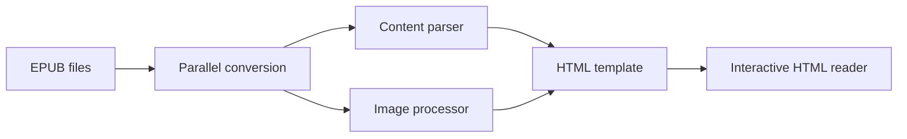

# EPUB to HTML | Parallel document converter

**Batch conversion of EPUB documents into interactive, browser-readable HTML.**

The project combines EPUB parsing, image processing, HTML templating and configurable parallel execution. Generated readers include themes, navigation and reading preferences.

## Architecture



## Performance

Python free-threading and optional optimized libraries are intended to improve throughput. Actual speed depends on hardware, input documents, dependencies and worker settings. No independently verified speedup or Lighthouse score is claimed here. Use the profiling instructions below to measure your own workload.

## Installation

### 1️⃣ Python 3.13 Free-Threaded (Recommended)

#### Option A: Pre-built Installer
1. Download Python 3.13+ from [python.org](https://www.python.org/downloads/)
2. Look for "free-threaded" or "no-GIL" builds
3. Install and verify:
```bash
python3.13 -c "import sys; print('GIL enabled:', sys._is_gil_enabled())"
# Should print: GIL enabled: False
```

#### Option B: Build from Source
```bash
# Download Python 3.13 source
wget https://www.python.org/ftp/python/3.13.0/Python-3.13.0.tgz
tar -xzf Python-3.13.0.tgz
cd Python-3.13.0

# Configure with free-threading
./configure --disable-gil
make -j$(nproc)
sudo make altinstall
```

### 2️⃣ System Dependencies

#### 🐧 Ubuntu/Debian
```bash
sudo apt-get update
sudo apt-get install libvips-dev build-essential
```

#### 🍎 macOS
```bash
brew install vips
```

#### 🪟 Windows

> [!IMPORTANT]
> Windows users need to install libvips separately for maximum performance.

**Option 1: Conda (Recommended)**
```bash
# Install conda from: https://docs.conda.io/en/latest/miniconda.html

# Create environment with libvips
conda create -n epub-converter python=3.13
conda activate epub-converter
conda install -c conda-forge libvips pyvips

# Install other dependencies
pip install jinja2 rjsmin rcssmin numpy lxml orjson selectolax zipfile-deflate64
```

**Option 2: Manual Installation**
1. Download libvips binaries from [libvips.github.io](https://libvips.github.io/libvips/install.html)
2. Extract to `C:\vips`
3. Add `C:\vips\bin` to your PATH environment variable
4. Restart your terminal/IDE

**Option 3: Quick Start (Pillow Fallback)**
```bash
# Skip pyvips installation - converter will use Pillow automatically
pip install jinja2 rjsmin rcssmin numpy lxml orjson selectolax zipfile-deflate64
```

### 3️⃣ Python Dependencies

```bash
# Install all dependencies
pip install jinja2 rjsmin rcssmin numpy lxml orjson pillow-simd pyvips selectolax zipfile-deflate64
```

---

## 🚀 Usage

### Basic Commands

```bash
# Convert single EPUB
python -m epub_converter book.epub

# Convert all EPUBs in directory (searches recursively)
python -m epub_converter /path/to/epub/files

# With custom output directory
python -m epub_converter /path/to/epub/files --output_dir /path/to/output

# Use more workers for faster processing
python -m epub_converter /path/to/epub/files --max_workers 200
```

### 🎛️ Command Line Flags

| Flag | Description | Default |
|------|-------------|---------|
| `epub_path` | Path to EPUB file or directory (searches recursively) | Required |
| `--output_dir` | Output directory for converted HTML files | Same as EPUB location |
| `--css` | Path to custom CSS file | Built-in styles |
| `--max_workers` | Maximum parallel workers | 100 (auto-adjusted for free-threading) |
| `--no-script` | Generate HTML only without static JS and CSS files | False |
| `--no-image` | Skip image processing, only generate HTML and static files | False |
| `--cover-only` | Only generate cover.avif next to each EPUB and exit | False |

### 🔥 Performance Optimization

#### For Maximum Speed (Python 3.13 Free-Threaded)
```bash
# Set environment variable to disable GIL
export PYTHON_GIL=0

# Use high worker count (8x CPU cores)
python -m epub_converter /path/to/epub/files --max_workers 200
```

#### Enable Performance Profiling
```bash
# Profile performance bottlenecks
EPUB_PROFILE=1 python -m epub_converter /path/to/epub/files
```

### 📝 Usage Examples

```bash
# Example 1: Convert single book with custom CSS
python -m epub_converter "my-book.epub" --css custom-theme.css

# Example 2: Batch convert with maximum performance
export PYTHON_GIL=0
python -m epub_converter "/library/books" --max_workers 200

# Example 3: Generate covers only (quick preview)
python -m epub_converter "/library/books" --cover-only

# Example 4: HTML only (no images, no scripts)
python -m epub_converter "book.epub" --no-script --no-image

# Example 5: Windows batch conversion
python -m epub_converter "C:\path\to\epubs" --max_workers 100
```

---

## 🔧 Configuration

### Environment Variables

| Variable | Description | Default |
|----------|-------------|---------|
| `PYTHON_GIL=0` | Force disable GIL (Python 3.13+) | GIL enabled |
| `EPUB_PROFILE=1` | Enable performance profiling | Disabled |
| `PYVIPS_CACHE_MAX` | Maximum pyvips cache size | 100 |
| `PYVIPS_CACHE_MAX_MEM` | Maximum pyvips memory cache | 500MB |

### Thread Pool Optimization

The converter automatically detects your system capabilities:

- **Free-threading enabled**: Uses `ThreadPoolExecutor` with up to 8x CPU cores
- **GIL-limited**: Uses `ProcessPoolExecutor` with CPU core count
- **Auto-scaling**: Adjusts worker count based on EPUB count and system resources

---

## 📁 Project Structure

```
epub-to-html/
├── src/
│   └── epub_converter/
│       ├── __main__.py          # CLI entry point with flag handling
│       ├── converter.py         # Main conversion logic (64KB)
│       ├── parser.py            # EPUB parsing and content extraction (49KB)
│       ├── image.py             # Image processing with pyvips/Pillow (22KB)
│       └── assets/
│           ├── reader.html      # Reader template with UI components
│           ├── script.js        # Interactive features (48KB)
│           └── style.css        # Themes and responsive design (30KB)
├── README.md                    # This file
└── .gitignore                   # Git ignore rules
```

---

## 🎨 Reader UI Components

The generated HTML reader includes:

### 📱 Responsive Layout
- Mobile-first design with breakpoints
- Touch-friendly controls
- Optimized for all screen sizes

### 🎨 Theme System
- **Light Themes**: Default, Ocean, Lipstick
- **Dark Themes**: Dark, Cyber, Solarized Dark, Nord
- **Sepia Theme**: Easy on the eyes
- Custom color schemes with smooth transitions

### ⚙️ Settings Panel
- **Font Size Slider**: 12-40px with live preview
- **Font Family Grid**: Multiple font options
- **Theme Cards**: Visual theme selection
- **Bionic Reading Toggle**: Enhanced reading mode
- **Persistent Storage**: Settings saved in localStorage

### 📑 Navigation
- **Table of Contents**: Collapsible sidebar
- **Progress Bar**: Visual reading progress
- **Chapter Navigation**: Previous/Next buttons
- **Scroll to Top**: Quick navigation

### 🖼️ Media Handling
- **Lazy Loading**: Optimized image loading
- **Modal View**: Full-screen image viewing
- **AVIF Format**: Modern, efficient image format
- **Async Decoding**: Non-blocking image rendering

---

## 📈 Performance Tuning

### For Large Batches (1000+ EPUBs)

1. **Use Python 3.13 free-threaded build**
2. **Increase worker count**: `--max_workers 200` (or higher)
3. **Ensure sufficient RAM**: 16GB+ recommended
4. **Use SSD storage**: Faster I/O for temp files
5. **Enable profiling**: Identify bottlenecks with `EPUB_PROFILE=1`

### Memory Optimization

- **pyvips streaming**: Processes images without loading full files into memory
- **Parallel processing**: Distributes memory usage across workers
- **Garbage collection**: Automatic cleanup of processed data

---

## 🐛 Troubleshooting

### Common Issues

#### ❌ "pyvips not available"
```bash
# Install libvips system library
sudo apt-get install libvips-dev  # Ubuntu/Debian
brew install vips                 # macOS

# Windows: See Windows installation section above
```

#### ❌ "selectolax not available"
```bash
pip install selectolax
```

#### ❌ "Free-threading not detected"
- Ensure Python 3.13+ is installed
- Check if free-threaded build is used
- Verify with: `python -c "import sys; print(sys._is_gil_enabled())"`

#### ❌ "cannot load library 'libvips-42.dll'" (Windows)
- **Solution**: Install libvips system library (see Windows setup)
- **Quick fix**: Uninstall pyvips to use Pillow fallback
  ```bash
  pip uninstall pyvips
  ```

#### ⚠️ Performance Issues
1. Enable profiling: `EPUB_PROFILE=1`
2. Check system resources (CPU, RAM, disk I/O)
3. Adjust `--max_workers` based on system capabilities
4. Ensure all dependencies are installed

### Fallback Behavior

The converter gracefully degrades if optimized libraries aren't available:

- **pyvips unavailable** → Falls back to Pillow
- **selectolax unavailable** → Falls back to lxml/regex
- **orjson unavailable** → Falls back to stdlib json
- **Free-threading unavailable** → Uses ProcessPoolExecutor

---

## 🧪 Testing & Benchmarking

### Test Performance

```bash
# Create test directory with sample EPUBs
mkdir test_epubs
# Copy some EPUB files to test_epubs/

# Benchmark with profiling
EPUB_PROFILE=1 python -m epub_converter test_epubs --max_workers 50

# Check results
ls *.prof  # Profile files
```

### Verify Installation

```bash
# Check Python version and GIL status
python -c "import sys; print(f'Python {sys.version_info.major}.{sys.version_info.minor}.{sys.version_info.micro}')"
python -c "import sys; print('GIL enabled:', sys._is_gil_enabled())"

# Test pyvips
python -c "import pyvips; print('pyvips working!')"

# Run converter with verbose output
python -m epub_converter test_epubs
```

---

## 🛠️ Technology Stack

### Core Technologies

| Component | Technology | Purpose |
|-----------|-----------|---------|
| **Language** | Python 3.13+ | Free-threading support |
| **Image Processing** | pyvips / libvips | Image processing |
| **HTML Parsing** | selectolax | Fast HTML/XML parsing |
| **XML Processing** | lxml | EPUB structure parsing |
| **JSON** | orjson | Fast serialization |
| **ZIP** | zipfile-deflate64 | Enhanced ZIP support |
| **Templating** | Jinja2 | HTML template rendering |
| **CSS Minification** | rcssmin | CSS optimization |
| **JS Minification** | rjsmin | JavaScript optimization |

### Frontend Technologies

| Component | Technology |
|-----------|-----------|
| **HTML** | Semantic HTML5 |
| **CSS** | Modern CSS with custom properties |
| **JavaScript** | Vanilla ES6+ |
| **Images** | AVIF format |
| **Icons** | SVG |
| **Storage** | localStorage API |

---

## 🎯 Use Cases

- **📚 Digital Libraries**: Convert entire EPUB collections to web-readable format
- **📖 Online Reading Platforms**: Serve books as interactive HTML
- **🔄 Format Migration**: Batch convert EPUBs for archival
- **📱 Mobile Reading**: Responsive reader for all devices
- **🎨 Custom Theming**: Apply custom styles to EPUB content
- **⚡ Quick Previews**: Generate covers only for library browsing

---

## 🤝 Contributing

1. Fork the repository
2. Create a feature branch (`git checkout -b feature/amazing-feature`)
3. Make your changes
4. Add tests if applicable
5. Commit your changes (`git commit -m 'Add amazing feature'`)
6. Push to the branch (`git push origin feature/amazing-feature`)
7. Open a Pull Request

---

## 📄 License

The previous documentation indicated MIT licensing, but a LICENSE file was not present in the repository root at review time. Confirm licensing before redistribution.

---

## 🙏 Acknowledgments

- **[pyvips/libvips](https://libvips.github.io/)** - Ultra-fast image processing
- **[selectolax](https://github.com/rushter/selectolax)** - Fast HTML parsing
- **[Python 3.13](https://www.python.org/)** - Free-threading support
- **[lxml](https://lxml.de/)** - Fast XML processing
- **[orjson](https://github.com/ijl/orjson)** - Fast JSON serialization
- **[Jinja2](https://jinja.palletsprojects.com/)** - Powerful templating

---

## 📞 Support

> [!TIP]
> **Need help?** Check the [Troubleshooting](#-troubleshooting) section first!

- 🐛 **Found a bug?** Open an issue on GitHub
- 💡 **Have a feature request?** Start a discussion
- 📖 **Need documentation?** Check this README
- 🪟 **Windows issues?** See the Windows-specific section above

---

<div align="center">

**Made with ❤️ for the EPUB community**

⭐ Star this repo if you find it useful! ⭐

</div>